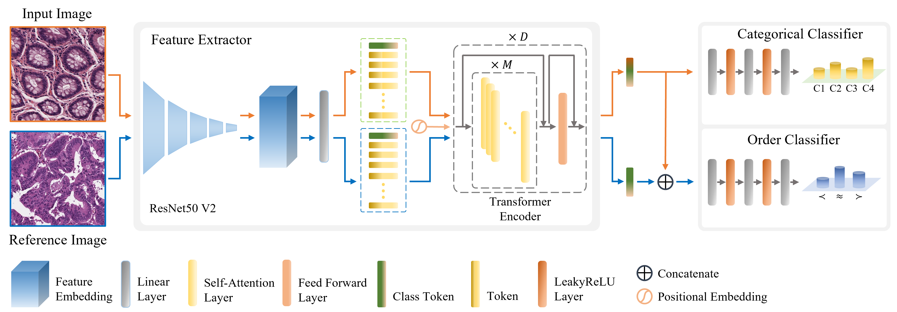

<div align="center">

# Order-ViT: Order Learning Vision Transformer for Cancer Classification in Pathology Images

[-B31B1B.svg)](https://openaccess.thecvf.com/content/ICCV2023W/CVAMD/html/Lee_Order-ViT_Order_Learning_Vision_Transformer_for_Cancer_Classification_in_Pathology_ICCVW_2023_paper.html)
[](https://openaccess.thecvf.com/ICCV2023_workshops/CVAMD)
<a href="https://pytorch.org/get-started/locally/"></a>
<a href="https://github.com/huggingface/pytorch-image-models"></a>

</div>

Order-ViT grades colon cancer in pathology images by jointly learning **categorical classification** (benign / well / moderately / poorly differentiated) and **order learning** (whether one image has a higher, equal or lower grade than another), and at test time re-decides uncertain predictions by voting over comparisons with confident reference images.



## Method in one paragraph

A ViT-R50 hybrid backbone (`vit_base_r50_s16_384`, timm) produces one feature per image. A class head (3-layer MLP) predicts the grade. Within each batch the images are randomly paired; an order head takes the concatenated pair features and predicts `>`, `=` or `<` of the grades. Loss = CE(grade) + `order_weight` x CE(order). At inference (`--voting`), samples whose top-1 minus top-2 probability is below a threshold are compared with `num_sample` "trusted" reference images per class (training images classified correctly with probability > 0.9); comparison results are turned into class votes and combined with the classifier probabilities by an entropy-weighted sum.

## Project structure

```
Order-ViT/
├── README.md
├── requirements.txt
├── configs/
│   └── colon.yaml          # all settings: data paths, backbone, optimizer, voting
├── splits/
│   └── colon_tma/          # train/valid/test CSVs (path relative to the image folder, class)
├── src/
│   ├── config.py           # YAML loading + `key.sub=value` overrides
│   ├── data.py             # dataset, augmentation, data loaders
│   ├── model.py            # Order-ViT model, order labels, joint loss, checkpoint loading
│   └── engine.py           # train/eval loops, metrics, reference bank and voting
├── train.py                # training entry point
├── test.py                 # evaluation entry point (optionally with voting)
├── tests/
│   └── test_smoke.py       # end-to-end test on random dummy data
└── assets/
    └── order_vit.png       # model figure
```

## Environment

Tested with Python 3.9, PyTorch 2.5.1 (CUDA 12.1), timm 1.0.30.

```bash
git clone https://github.com/JcLee96/Order-ViT.git
cd Order-ViT
conda create -n order_vit python=3.9 -y
conda activate order_vit
pip install torch torchvision --index-url https://download.pytorch.org/whl/cu121
pip install -r requirements.txt
```

## Dataset

Colon cancer grading datasets from Kangbuk Samsung Hospital (KBSMC): <https://github.com/QuIIL/KBSMC_colon_cancer_grading_dataset>

- `KBSMC_colon_tma_cancer_grading_1024` - training, validation and Test I
- `KBSMC_colon_45wsis_cancer_grading_512` - Test II (independent WSI patches)

Place them under `data/` (or change the paths in `configs/colon.yaml`):

```
data/
├── colon_tma/              # content of KBSMC_colon_tma_cancer_grading_1024
│   ├── 1010711/
│   │   ├── 91109_17705_3.jpg
│   │   └── ...
│   └── ...
└── colon_test2/            # content of KBSMC_colon_45wsis_cancer_grading_512
    └── <wsi>/<region>/<name>_<grade 1-4>.png
```

Labels: 0 benign, 1 well, 2 moderately, 3 poorly differentiated. Training/validation/Test I membership is defined by `splits/colon_tma/*.csv`; Test II labels are read from the file-name suffix.

## Usage

Train (best checkpoint by validation accuracy is saved to `outputs/colon/best.pt`, then evaluated on Test I):

```bash
python train.py --config configs/colon.yaml
# any setting can be overridden, e.g.
python train.py train.epochs=30 data.batch_size=8 output_dir=outputs/run1
```

Test:

```bash
# plain classification on Test I
python test.py --ckpt outputs/colon/best.pt
# with order-based voting on Test II
python test.py --ckpt outputs/colon/best.pt --split test2 --voting voting.num_sample=10
```

Reported metrics: accuracy, macro F1, quadratic weighted kappa and the confusion matrix (voting also reports the accuracy before voting and the number of changed predictions).

## Smoke test

Builds a tiny random dataset, trains a small ViT for one epoch, evaluates, runs voting and reloads the checkpoint (no download needed):

```bash
python tests/test_smoke.py      # or: pytest tests
```

## Citation

If you use this code, please cite:

> Order-ViT: Order Learning Vision Transformer for Cancer Classification in Pathology Images. ICCV 2023 Workshops (CVAMD). [[paper]](https://openaccess.thecvf.com/content/ICCV2023W/CVAMD/html/Lee_Order-ViT_Order_Learning_Vision_Transformer_for_Cancer_Classification_in_Pathology_ICCVW_2023_paper.html)

## License
Released under the [MIT License](LICENSE).
